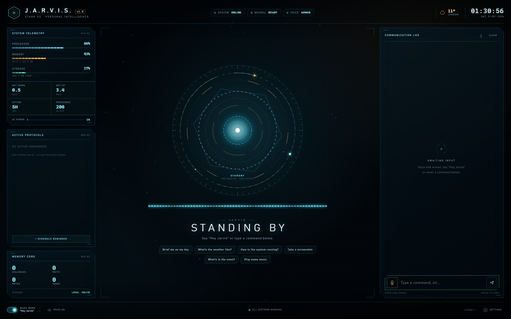

# J.A.R.V.I.S.

A local, voice-first JARVIS-style assistant for Windows: an always-on **“Hey Jarvis”** wake word, on-device speech recognition, a British synthesized voice, streaming OpenRouter reasoning with real tool use, persistent memory, and a holographic HUD.



> A functional homage to the JARVIS interface — not affiliated with Marvel or Stark Industries. It is a real desktop assistant, not a fictional AGI.

---

## Download for Windows

**[Download the latest release](https://github.com/ilyeessgg-ux/jarvis/releases/latest)** (`JARVIS-1.0.0-win64.zip`, Windows 10/11 x64).

1. Download and extract the zip anywhere you like.
2. Run **`JARVIS.exe`**.
3. On first launch, open the tray icon → **Edit settings (.env)** and add your [OpenRouter API key](https://openrouter.ai/settings/keys) or [AgentRouter API key](https://agentrouter.org), then restart JARVIS. AgentRouter users also need `OPENROUTER_BASE_URL=https://agentrouter.org/v1` and `OPENROUTER_MODEL=deepseek-v4-flash`; see [Using AgentRouter](#using-agentrouter).

The app starts **in the background** with a tray icon. Say **“Hey Jarvis”** and the HUD opens, chimes, and starts listening. Closing the window hides it back to the tray; use the tray menu to reopen it or quit.

> The build is not code-signed, so Windows SmartScreen may ask for confirmation. Choose **More info → Run anyway**.

### Background and tray behaviour

| Action | Result |
|---|---|
| Say **“Hey Jarvis”** | Opens the HUD and records your command |
| Double-click `JARVIS.exe` again | Reveals the already-running window |
| Close the window | Hides to the tray; voice stays active |
| Tray → **Open J.A.R.V.I.S.** | Shows the HUD |
| Tray → **Listen now** | Opens the HUD and starts listening immediately |
| Tray → **Wake word** | Toggles always-on wake detection |
| Tray → **Start with Windows** | Adds/removes the current-user sign-in entry |
| Tray → **Edit settings (.env)** | Opens the config file |
| Tray → **Quit J.A.R.V.I.S.** | Fully exits the app |

Command-line options: `JARVIS.exe --window` starts with the window visible instead of hidden, and `JARVIS.exe --install-autostart` / `--uninstall-autostart` manage sign-in startup.

### Where files live in the packaged app

| Path | Contents |
|---|---|
| `.env` next to `JARVIS.exe` | API key and startup settings |
| `%LOCALAPPDATA%\JARVIS\jarvis.db` | Conversation history, facts, notes, reminders, settings |
| `%LOCALAPPDATA%\JARVIS\logs\` | `jarvis.log` and diagnostics |
| `%LOCALAPPDATA%\JARVIS\screenshots\` | Screenshots taken by the assistant |
| `%LOCALAPPDATA%\JARVIS\cache\` | Cached synthesized speech |

The install folder is never written to, so the app can live in `Program Files` or on a removable drive.

---

## What works

| Capability | Implementation |
|---|---|
| Wake word | **openWakeWord** `hey_jarvis_v0.1`, fully on-device, adjustable sensitivity |
| Speech-to-text | **faster-whisper** `base.en`, local CPU (int8) |
| Voice | **edge-tts** British voices, default `en-GB-RyanNeural`; cached; Windows SAPI fallback |
| Brain | **OpenRouter** streaming chat completions + OpenAI-compatible tool calling |
| Conversation | Multi-turn context, persistent SQLite history, facts, notes |
| PC control | Open apps / URLs / folders, volume, media keys, screenshots, clipboard, window control, lock, power actions |
| Information | Live weather + forecast, web search, news headlines |
| Time & tasks | Date/time, natural-language reminders with spoken alerts, notes, long-term facts |
| Interface | Boot sequence, animated arc reactor, live waveform, telemetry, transcript, quick actions, settings, screenshot lightbox |
| Input modes | Wake word, global push-to-talk `Ctrl+Alt+J`, text console, quick-action chips |
| Privacy | Wake word and STT are local; API key never reaches the browser; database stays on disk |

The toolbelt contains **25 tools**, including weather, web search, news, app launching, system telemetry, volume/media control, screenshots, clipboard, reminders, notes, and memory.

---

## Run from source

Requirements: Windows 10/11 x64, PowerShell 5+, a microphone, and internet access for the first setup.

```powershell
git clone https://github.com/ilyeessgg-ux/jarvis.git
cd jarvis
.\setup.ps1
```

`setup.ps1` downloads an isolated 64-bit Python 3.12 runtime into `runtime/`, installs dependencies, fetches the wake-word and Whisper models, and creates `.env`. Add your OpenRouter key to `.env`, then:

```powershell
# Background + tray (same behaviour as the packaged app)
.\run.ps1 -Background

# Native desktop window (pywebview / WebView2)
.\run.ps1 -Window

# HUD in your default browser
.\run.ps1

# Start quietly, without the spoken greeting
.\run.ps1 -NoGreeting
```

The HUD is served at **http://127.0.0.1:7777**. Say **“Hey Jarvis”**, wait for the chime, and speak. Press **Ctrl+Alt+J** anywhere in Windows to push-to-talk, or type in the command bar.

---

## Example commands

- “Hey Jarvis, what’s the weather in Tokyo?”
- “Hey Jarvis, take a screenshot.”
- “Hey Jarvis, how is the system running?”
- “Hey Jarvis, open Notepad.”
- “Hey Jarvis, set a reminder to call Mum at 6pm.”
- “Hey Jarvis, what’s in the news about AI?”
- “Hey Jarvis, search the web for the latest RTX prices.”
- “Hey Jarvis, remember that my favourite tea is Earl Grey.”
- “Hey Jarvis, set the volume to 30 percent.”
- “Hey Jarvis, lock the PC.” *(asks for confirmation on power actions)*

---

## How it is put together

```text
┌──────────────────────────── Browser HUD (web/) ────────────────────────────┐
│  reactor · waveform · transcript · telemetry · settings · screenshot view  │
└───────────────────────────────▲───────────────┬────────────────────────────┘
                                │ SSE events    │ REST commands
┌───────────────────────────────┴───────────────▼────────────────────────────┐
│                         Flask server (server.py)                           │
└───────────────────────────────┬────────────────────────────────────────────┘
                                │
┌───────────────────────────────▼────────────────────────────────────────────┐
│                    Assistant orchestrator (assistant.py)                   │
│  conversation queue · state machine · system prompt · tool loop · speech   │
├───────────────┬───────────────┬───────────────┬───────────────┬────────────┤
│ OpenRouter    │ Toolbox       │ Memory        │ Audio engine  │ Reminders  │
│ streaming +   │ 25 Windows /  │ SQLite: chat, │ openWakeWord  │ scheduler  │
│ tool calling  │ web tools     │ facts, notes  │ + VAD recorder│ + TTS      │
└───────────────┴───────────────┴───────────────┴───────────────┴────────────┘
                                      │
                        faster-whisper STT · edge-tts
```

- **Audio thread** listens at 16 kHz in 80 ms frames, runs the wake model, then records a command using an adaptive energy VAD. It pauses while Jarvis speaks to avoid feedback.
- **Brain worker** serializes turns, streams model output to the HUD, executes tools, and speaks the final answer.
- **SSE** pushes state, mic level, deltas, tool activity, reminders, and errors to the HUD in real time.
- **Desktop shell** (`desktop.py`, `tray.py`) keeps the native window hidden in the tray, shows it on wake, and enforces a single running instance.

---

## Configuration

Settings can be changed live in the HUD’s **SETTINGS** panel. They are stored in the SQLite database. Environment variables in `.env` seed the database on first run.

| Variable | Default | Purpose |
|---|---|---|
| `OPENROUTER_API_KEY` | — | **Required.** API key for your provider. Stored only in `.env` |
| `OPENROUTER_BASE_URL` | `https://openrouter.ai/api/v1` | OpenAI-compatible endpoint. Set to `https://agentrouter.org/v1` for AgentRouter |
| `OPENROUTER_MODEL` | `nvidia/nemotron-3.5-super-vl:free` | Tool-capable model ID for the selected provider |
| `JARVIS_USER_NAME` | `sir` | How Jarvis addresses you |
| `JARVIS_CITY` | `London` | Default weather location |
| `JARVIS_VOICE` | `en-GB-RyanNeural` | edge-tts voice |
| `JARVIS_WAKE_ENABLED` | `true` | Arm the wake word at startup |
| `JARVIS_SPEAK_REPLIES` | `true` | Speak answers aloud |
| `JARVIS_WAKE_THRESHOLD` | `0.55` | Wake sensitivity; lower = more sensitive |
| `JARVIS_HOST` / `JARVIS_PORT` | `127.0.0.1` / `7777` | HUD bind address |

**Model notes:** the default is a free tool-capable model. Free models can be rate-limited by their upstream providers. If you add credit, switch to a stronger paid model such as `openai/gpt-4o-mini` in Settings. Models must support tool calling.

### Using AgentRouter

J.A.R.V.I.S. talks to any OpenAI-compatible chat-completions endpoint, so an
[AgentRouter](https://agentrouter.org) key works without code changes. The
`OPENROUTER_*` variable names are kept for backwards compatibility; the base
URL decides which provider is used.

1. Quit JARVIS fully from the tray.
2. Edit the `.env` next to `JARVIS.exe` (tray → **Edit settings (.env)**) and
   replace the OpenRouter lines with:

   ```dotenv
   OPENROUTER_API_KEY=<your AgentRouter API key>
   OPENROUTER_BASE_URL=https://agentrouter.org/v1
   OPENROUTER_MODEL=deepseek-v4-flash
   ```

3. If you have already run JARVIS before, open **SETTINGS → NEURAL MODEL** and
   enter `deepseek-v4-flash`, then **SAVE CONFIGURATION**. The model is stored in
   the local database; `.env` only seeds it on a fresh install.
4. Restart JARVIS. The HUD should show **READY** instead of **NO KEY**.

AgentRouter's OpenAI-compatible base URL is `https://agentrouter.org/v1`.
`deepseek-v4-flash` is the model used in AgentRouter's own OpenCode guide and is
a good low-cost default. Other current tool-capable choices include `glm-5.3`
and `gpt-5.6-sol`; model availability changes, so check your AgentRouter console.
If a model errors with `503 no available channel`, choose another model from the
console. The model field in the HUD is free text, so any tool-capable model ID
can be used.

Wake-word and Whisper models are bundled into the release, so the packaged app works offline for listening and transcription. The first spoken line is slower while the voice cache warms up.

---

## Build the Windows EXE

The release is a PyInstaller **one-folder** build: `dist\JARVIS\JARVIS.exe` plus its libraries. This starts faster and is more reliable than a one-file bundle for native model DLLs.

```powershell
# One-time: isolated runtime + dependencies + models
.\setup.ps1

# Install build tooling into the isolated runtime
.\runtime\python.exe -m pip install -r requirements-dev.txt

# Build and zip (runs model download if needed)
.\build_exe.ps1 -Clean
```

Outputs:

- `dist\JARVIS\JARVIS.exe`
- `dist\JARVIS-1.0.0-win64.zip`

The build embeds `web/`, `assets/`, the openWakeWord models, and the flat `models/whisper/base.en` model. It writes a placeholder `.env` next to the executable and copies this README and the license into the release folder.

To build with a different Python (for example in CI), pass `-Python`:

```powershell
.\build_exe.ps1 -Clean -Python (Get-Command python).Source
```

### GitHub release workflow

`.github/workflows/build-windows.yml` builds the zip on `windows-latest` and uploads it as a workflow artifact on manual runs. Pushing a version tag creates a GitHub release with the zip attached:

```powershell
git tag v1.0.0
git push origin v1.0.0
```

---

## Security and privacy

- The OpenRouter key is read from `.env`, is never embedded in the HUD, and `.env` is git-ignored.
- The HUD and API bind to **127.0.0.1** by default. Do not expose the port to the internet — the local API has no authentication.
- Conversation history, facts, notes, and reminders live in the local SQLite database. Use **EXPORT MEMORY** in Settings to download a JSON copy.
- Wake word detection and speech-to-text are **local**. Weather/search/news calls go directly to their public APIs. OpenRouter receives your prompts. edge-tts sends the text it speaks to Microsoft’s speech service; if that is unavailable, the Windows SAPI fallback is used.
- Shutdown, restart, and sleep tools require explicit confirmation. Power actions schedule a 45-second delay so they can be cancelled.
- If an API key is ever exposed, revoke it at <https://openrouter.ai/settings/keys> and put a new key in `.env`.

---

## Troubleshooting

| Symptom | Fix |
|---|---|
| SmartScreen warning on first run | The EXE is unsigned. **More info → Run anyway**, or build it yourself. |
| Window did not appear after launch | It is in the tray by default. Say “Hey Jarvis”, press `Ctrl+Alt+J`, or choose **Open J.A.R.V.I.S.** from the tray menu. |
| “NO KEY” in the top bar | Add `OPENROUTER_API_KEY=...` to `.env` (tray → **Edit settings**) and restart. |
| HTTP 402 “requires more credits” | The account has no paid credit. Keep the free model, or add credit and choose a paid model in Settings. |
| Microphone OFFLINE | Check Windows **Settings → Privacy → Microphone**, and that a default input device exists. Text commands still work. |
| Wake word misses | Lower `wake_threshold` to `0.45` in Settings, speak a little closer, and check the mic meter. Raise it to `0.65` if it wakes on its own. |
| No voice | edge-tts needs internet. The SAPI fallback uses the installed Windows voice. Check the log. |
| First answer is slow | Whisper and the OpenRouter model are warming up. Subsequent turns are faster. |
| Native window is blank | Install the Microsoft Edge WebView2 Runtime, or use `.\run.ps1` (browser). |
| Port 7777 already in use | Use `--port 7788`, or stop the other process. |
| Reset everything | Quit JARVIS and delete `%LOCALAPPDATA%\JARVIS\jarvis.db` (export first if needed). |

Logs: `%LOCALAPPDATA%\JARVIS\logs\jarvis.log` for the packaged app, or `data/logs/jarvis.log` from source. Run `JARVIS.exe --diagnose` for an environment report.

---

## Project layout

```text
jarvis/
├─ app.py                  entry point, CLI, single instance, server, hotkeys
├─ jarvis_core/
│  ├─ assistant.py         orchestration, tool loop, state machine
│  ├─ audio.py             wake word + VAD recorder
│  ├─ autostart.py         current-user sign-in entry
│  ├─ config.py            paths, environment defaults, persona, voices
│  ├─ desktop.py           native window, wake-to-show, tray wiring
│  ├─ events.py            thread-safe SSE event bus
│  ├─ llm.py               OpenRouter streaming + tool-call assembly
│  ├─ memory.py            SQLite: messages, facts, notes, reminders, settings
│  ├─ scheduler.py         spoken reminders
│  ├─ server.py            Flask REST + SSE API
│  ├─ stt.py               faster-whisper
│  ├─ tools.py             25-tool Windows/web toolbelt
│  ├─ tray.py              system tray menu and icon
│  └─ tts.py               edge-tts + cache + SAPI fallback
├─ web/                    HUD (no CDN, no external assets)
├─ assets/                 app / tray icon
├─ docs/                   HUD screenshot used by this README
├─ packaging/              Windows version metadata
├─ scripts/                icon and archive helpers
├─ models/                 openWakeWord + Whisper (git-ignored)
├─ data/                   source-mode database, cache, logs (git-ignored)
├─ runtime/                isolated Python 3.12.10 (git-ignored)
├─ .env                    secret key (git-ignored)
├─ jarvis.spec             PyInstaller definition
├─ build_exe.ps1           Windows release build + zip
├─ setup.ps1               isolated runtime + dependencies + models
├─ run.ps1                 source launcher
└─ start_jarvis.cmd        double-click native-window launcher
```

### CLI helpers

```powershell
.\runtime\python.exe app.py --diagnose        # environment report, no secrets
.\runtime\python.exe app.py --ask "What time is it?"
.\runtime\python.exe app.py --say "Good evening, sir."
.\runtime\python.exe download_models.py       # re-fetch / verify models
```

### Keyboard shortcuts

| Shortcut | Action |
|---|---|
| `Ctrl+Alt+J` | Push-to-talk (global) |
| `Ctrl+Alt+S` | Stop speaking / cancel the current turn |
| `Ctrl+K` | Focus the text console |
| `Enter` | Send a typed command |
| `Esc` | Close settings or the screenshot lightbox |

---

## Limits

This is a software JARVIS for a normal Windows PC. It cannot control an Iron Man suit, project holograms, or reason like a fictional AGI. It is intentionally local-first: wake word and transcription stay on the machine; language reasoning and neural speech synthesis use online services. Windows is required for the PC-control tools.

## License

MIT — see [LICENSE](LICENSE).
